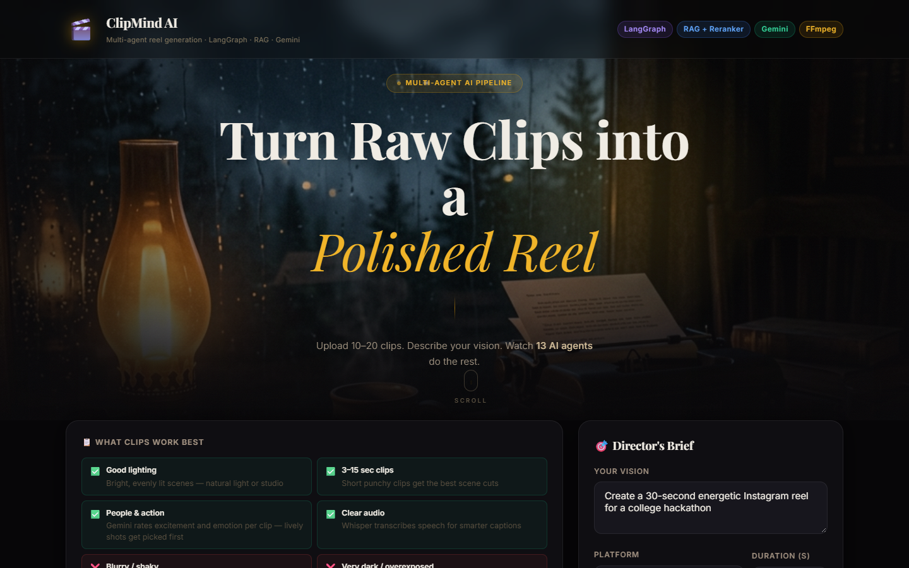
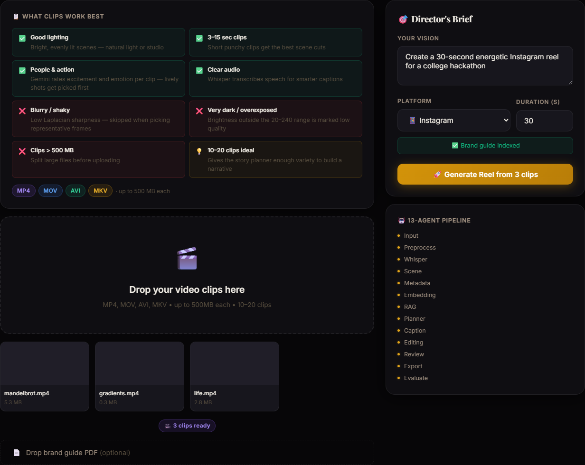
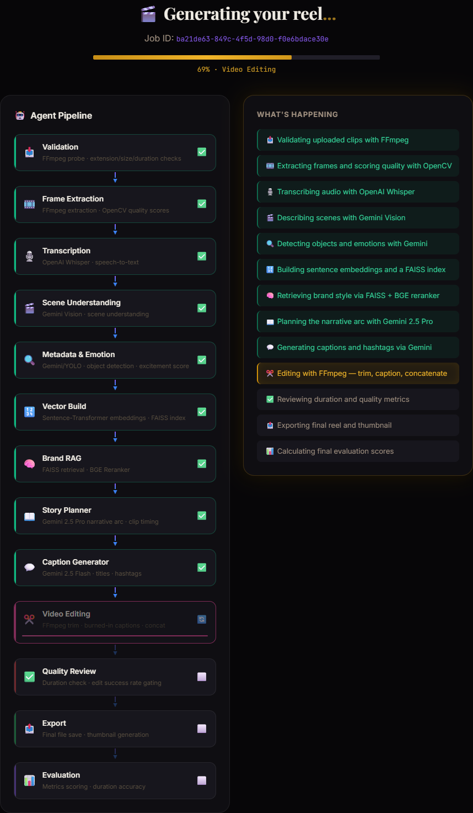
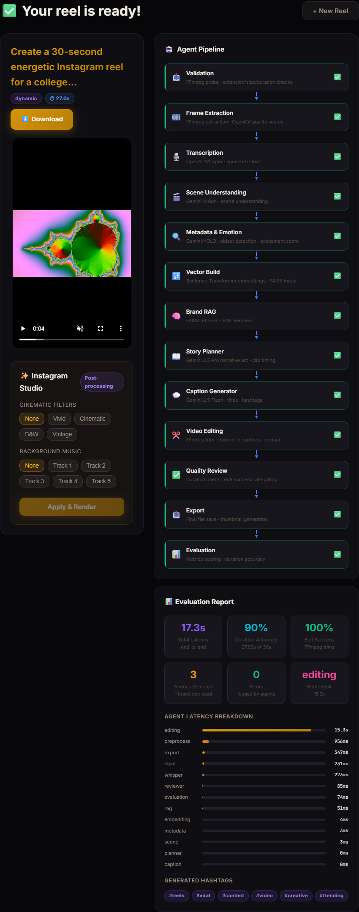

# CLIPMIND AI

**A multi-agent LangGraph pipeline that turns raw video clips and a one-line brief into a captioned, platform-ready reel.**

Most short-form video is cut by hand: watch every clip, pick the good moments, trim, order them into
something with a beginning and an end, write captions and hashtags, export at the right aspect ratio.
ClipMind AI hands each of those steps to its own agent and wires them together in a LangGraph state machine.

You upload clips (and optionally a brand style-guide PDF) and write a brief such as *"a 30-second energetic
Instagram reel for a college hackathon"*. Thirteen agents then validate the footage, sample and score
frames, transcribe speech with Whisper, describe each scene with Gemini Vision, retrieve brand rules with
RAG (FAISS + a BGE reranker), plan a story arc, write captions, cut the video with FFmpeg, review it, and
export it with a thumbnail and an evaluation report. The React dashboard shows every agent live as it runs.


*The ClipMind AI dashboard. Clips and a brief go in; the agent pipeline, the finished reel and its evaluation come out.*

## Design questions

1. Can a graph of narrow, single-purpose agents (each one testable on its own) produce a usable reel
   end to end, with a review loop that catches bad renders before export?
2. Does retrieving brand rules from a style guide (RAG + reranking) give the planner and caption writer
   context they would not get from the brief alone?
3. Can every step degrade gracefully, so a run still finishes without a Gemini key, Whisper or a GPU?

## Architecture (short version)

```
 Clips + brief + brand PDF ──> FastAPI ──> LangGraph StateGraph (SQLite checkpoints) ──> outputs/ ──> React dashboard
                                  │                                                         ▲
                                  └──────── WebSocket: per-agent progress + timings ────────┘

 input → preprocess → whisper → scene → metadata → embedding → rag → planner → caption → editing → reviewer ─┬→ export → evaluation
                                                                                             ▲                 │
                                                                                             └─ retry (≤3) ────┘
```

| # | Agent | What it does | Main tools |
|---|---|---|---|
| 1 | `input_agent` | checks extension, size and duration; probes resolution, fps, audio | FFmpeg |
| 2 | `preprocess_agent` | samples 1 frame/s, scores sharpness (Laplacian) and brightness | FFmpeg, OpenCV |
| 3 | `whisper_agent` | extracts 16 kHz audio, transcribes with timestamps | Whisper |
| 4 | `scene_agent` | describes one representative frame per clip: mood, setting, quality ratings | Gemini Vision → BLIP fallback |
| 5 | `metadata_agent` | objects, people count, dominant emotion, excitement score | Gemini Vision → YOLOv8 fallback |
| 6 | `embedding_agent` | embeds transcript + scene descriptions into a per-job FAISS index | Sentence-Transformers, FAISS |
| 7 | `rag_agent` | chunks the brand PDF, retrieves top-10 for brief + scenes, reranks to top-3 | FAISS, BGE reranker |
| 8 | `planner_agent` | picks clips, in/out points and transitions as a story arc near the target length | Gemini 2.5 Pro → heuristic fallback |
| 9 | `caption_agent` | title, tone, music mood, per-scene captions, hashtags, CTA per platform | Gemini 2.5 Flash → template fallback |
| 10 | `editing_agent` | trims, scales/pads to 9:16 or 16:9, burns captions, concatenates | FFmpeg |
| 11 | `reviewer_agent` | checks the render exists, trims succeeded, duration vs. target; sends back for a retry | FFmpeg |
| 12 | `export_agent` | final MP4, thumbnail, metadata JSON | FFmpeg |
| 13 | `evaluation_agent` | duration accuracy, edit success rate, counts, errors, retries | - |

The shared state is one `TypedDict` ([memory/state.py](memory/state.py)) that flows through every node;
`logs`, `errors` and `agent_timings` use reducers so each agent only returns what it adds.
The graph is in [graphs/workflow.py](graphs/workflow.py).

## Stack

| Layer | Tool |
|---|---|
| Orchestration | LangGraph `StateGraph` + `SqliteSaver` checkpoints, optional LangSmith tracing |
| LLM / vision | Gemini 2.5 Flash (vision, captions) + Gemini 2.5 Pro (planning) via `google-genai` |
| Fallback vision | BLIP (Salesforce/blip-image-captioning-base), YOLOv8n (optional) |
| Speech-to-text | OpenAI Whisper (`base` by default) |
| Embeddings | Sentence-Transformers `all-MiniLM-L6-v2` |
| Vector DB | FAISS (pipeline) + ChromaDB (benchmark comparison) |
| Reranker | BGE cross-encoder `BAAI/bge-reranker-base` |
| Video | FFmpeg (system or bundled via `imageio-ffmpeg`) + OpenCV |
| API | FastAPI, WebSockets, background tasks |
| Frontend | React 19 + Vite + TypeScript |
| Tests | pytest (`python -m pytest -q`) |
| Deploy | Docker Compose (API + nginx-served dashboard) |

## What it does

- **Upload and brief:** drag in clips (MP4, MOV, AVI, MKV, WebM, M4V; up to 500 MB each) and an optional
  brand guide PDF, pick a platform (Instagram, TikTok, YouTube, generic) and a target length (10-300 s).
- **Understand the footage:** frames are scored for sharpness and exposure, speech is transcribed, and
  each clip gets a description, mood, objects and an excitement score.
- **Brand-aware planning:** the brand guide is chunked, embedded and searched; the three best chunks
  (after reranking) go into the planner and caption prompts. Without a PDF the agent searches the job's
  own transcript and scene index instead.
- **Edit and review:** segments are cut at 30 fps to the platform frame (1080×1920 or 1920×1080) with
  burned-in captions and a silent track where a clip has no audio, then concatenated. The reviewer sends
  the edit back (up to `MAX_AGENT_RETRIES` times) if the render is missing or fewer than 70% of trims
  succeeded; a duration off target is logged as a warning.
- **Studio:** after a run, re-render the reel with a colour filter (vivid, cinematic, B&W, vintage)
  and/or background music. Each combination gets its own file, and it always starts from the original export.
- **Dashboard** (http://localhost:5173): live agent graph and progress bar over WebSocket, video player
  with thumbnail and download, captions and click-to-copy hashtags, evaluation scores and a per-agent
  latency chart.
- **Failure handling:** every Gemini/Whisper/model step has a fallback and logs why it was used, so the
  pipeline always reaches export. Each run is checkpointed per job in `pipeline/checkpoints.db`.

## Screenshots

| Upload and brief | Pipeline running |
|---|---|
|  |  |
| Drop in clips and an optional brand-guide PDF, write the brief, pick a platform and a length. | Every agent reports over the WebSocket as it starts and finishes; the right column explains each step. |

| Finished reel |
|---|
|  |
| The 9:16 reel with download and Studio re-render (filters, music), the completed pipeline, and the evaluation report: duration accuracy, edit success, errors and per-agent latency. Captured with synthetic test clips and no Gemini key, so title, captions and hashtags come from the fallback paths. |

## Results at a glance

End-to-end smoke test on 2026-10-21: three synthetic 8-second 720p clips, 15-second Instagram target,
no Gemini key and no Whisper/torch installed (so every fallback path ran), on a Windows laptop CPU.

| Check | Result |
|---|---|
| Agents completed | 13 / 13, live `running`/`done` events for each over the WebSocket |
| Output | 1080×1920 MP4 with audio, **15.02 s for a 15 s target** (duration accuracy 0.999) |
| Edit success / review retries | 100% of trims, 0 retries, 0 errors |
| Where the time goes | `editing_agent` 16.7 s of ~20.3 s total (FFmpeg re-encode); everything else < 1 s each |
| Studio | filter-only and filter + music re-renders both succeed; a missing music file returns a clear 400 |
| Unit tests | 16 passed (state, routing, planner clamping, chunking, caption escaping, metrics) |

With a Gemini key the scene, metadata, planner and caption steps call the API instead, so expect those
agents to take seconds rather than milliseconds. Whisper, BLIP and the BGE reranker download their models
on first use.

## Running it

You need Python 3.11+ and Node 20.19+ (or 22). FFmpeg is optional: if it is not on your PATH, the
bundled `imageio-ffmpeg` binary is used.

```bash
git clone https://github.com/Abhxym/ClipMind-AI.git
cd ClipMind-AI
python -m venv .venv
.venv\Scripts\activate                  # macOS/Linux: source .venv/bin/activate
pip install -r requirements.txt
cp .env.example .env                    # then set GOOGLE_API_KEY (from https://aistudio.google.com/apikey)

# backend: API on :8000
python -m api.main

# frontend (second terminal): dashboard on :5173, proxies /api and /outputs to :8000
cd frontend
npm install
npm run dev                             # API not on :8000? set API_PROXY_TARGET=http://localhost:<port>

# or both at once on Windows
.\start.ps1

# or with Docker (API + nginx-served dashboard)
docker compose up --build

# tests
python -m pytest -q

# RAG benchmark: FAISS vs Chroma × chunk size 256/512/1024 × top-K 3/5/10 × reranker on/off
python rag/brand_kb/sample_brand_guide.py          # writes rag/brand_kb/sample_brand_guide.txt
python -m evaluation.benchmark --brand-pdf rag/brand_kb/sample_brand_guide.txt
#   → evaluation/results/rag_benchmark.csv
```

**Studio music:** no tracks ship with the repo. Put your own royalty-free `track1.mp3` … `track5.mp3`
in `api/assets/music/` (or point `MUSIC_DIR` elsewhere) to enable the music buttons.

**Captions in the video:** FFmpeg's `drawtext` needs a font. If captions don't show up, set
`CAPTION_FONT_FILE` in `.env` (for example `C:/Windows/Fonts/arial.ttf`); without one, segments are
rendered without captions rather than failing. The Docker image sets this for you.

| Service | URL |
|---|---|
| **Dashboard** | **http://localhost:5173** |
| API | http://localhost:8000 |
| API docs (Swagger) | http://localhost:8000/docs |
| Health | http://localhost:8000/health |
| Rendered files | http://localhost:8000/outputs/ |

### API

| Method | Path | What |
|---|---|---|
| POST | `/api/upload/video` | upload one clip → `server_path` |
| POST | `/api/upload/brand-pdf` | upload a brand guide PDF → `server_path` |
| POST | `/api/jobs` | start a job (`user_prompt`, `target_duration`, `platform`, `clip_paths`, `brand_pdf_path`) |
| WS | `/api/ws/{job_id}` | live `progress` events per agent |
| GET | `/api/jobs/{job_id}/status` | per-agent status, timings, errors |
| GET | `/api/jobs/{job_id}/result` | video/thumbnail URLs, title, captions, hashtags, evaluation |
| POST | `/api/jobs/{job_id}/enhance` | Studio re-render (`filter_type`, `music_track`) |
| GET | `/api/jobs/{job_id}/download/{filename}` | download one of the job's output files |

## Configuration

All settings live in [.env.example](.env.example). The ones you are most likely to change:

| Variable | Default | What |
|---|---|---|
| `GOOGLE_API_KEY` | - | Gemini key; without it every Gemini step uses its fallback |
| `GEMINI_MODEL` / `GEMINI_MODEL_CAPTION` / `GEMINI_MODEL_PLANNER` | `gemini-2.5-flash` / `gemini-2.5-flash` / `gemini-2.5-pro` | models per step |
| `WHISPER_MODEL` | `base` | `tiny` … `large` |
| `EMBEDDING_MODEL`, `RERANKER_MODEL` | `all-MiniLM-L6-v2`, `BAAI/bge-reranker-base` | RAG models |
| `CHUNK_SIZE`, `TOP_K_RETRIEVE`, `TOP_K_RERANK` | 512, 10, 3 | brand-guide RAG |
| `BLUR_THRESHOLD`, `BRIGHTNESS_MIN/MAX` | 30, 20/240 | frame quality gates |
| `MAX_AGENT_RETRIES` | 3 | max editing passes in the review loop |
| `MAX_UPLOAD_SIZE_MB` | 500 | per-file upload limit |

## Where to look

| Path | About |
|---|---|
| [graphs/workflow.py](graphs/workflow.py) | the graph, the review router, progress/timing instrumentation, checkpointing |
| [memory/state.py](memory/state.py) | the shared `VideoState` and its reducers |
| [agents/](agents/) | one file per agent |
| [tools/](tools/) | FFmpeg, Whisper, embeddings, reranker, PDF and OpenCV helpers shared by the agents |
| [api/](api/) | FastAPI app, upload/jobs/WebSocket routes, Pydantic models |
| [rag/](rag/) | FAISS/Chroma vector DB, chunking and reranker used by the benchmark; sample brand guide |
| [evaluation/](evaluation/) | run-level metrics (latency breakdown, ROUGE-L, P@K, hallucination proxy) and the RAG benchmark |
| [frontend/](frontend/) | React dashboard ([frontend/README.md](frontend/README.md)) |
| [tests/](tests/) | pytest suite |

## Project status

**Working end to end** (13 agents, review loop, live dashboard, Studio re-render, Docker).

**Limits, honestly:** jobs are kept in memory, so restarting the API forgets them (the checkpoints stay
in SQLite but are not resumed). One job runs per background thread with no queue. Scene understanding
looks at a single representative frame per clip, not the whole clip. Transitions in the plan are
recorded but every cut is a hard cut. The review loop re-renders the same plan, so it fixes transient
FFmpeg failures, not a plan that is too short. Evaluation scores the output against the target and the
plan, not against human judgement, and the smoke test above used synthetic clips, not real footage.
The root `index.html` is a standalone landing-page mock-up and is not part of the dashboard.

## License

MIT
